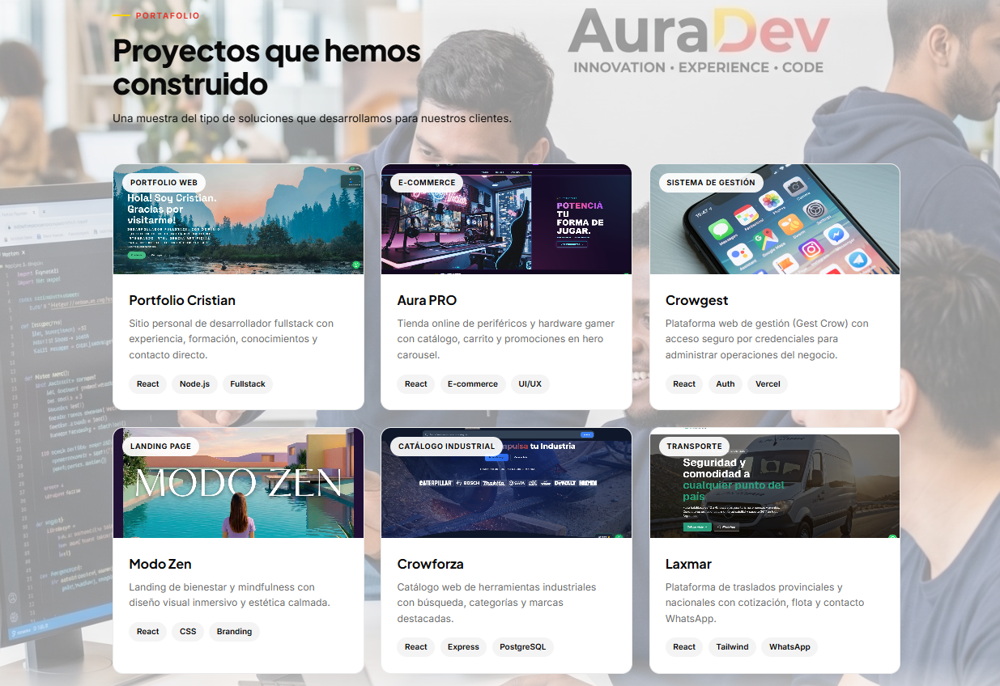
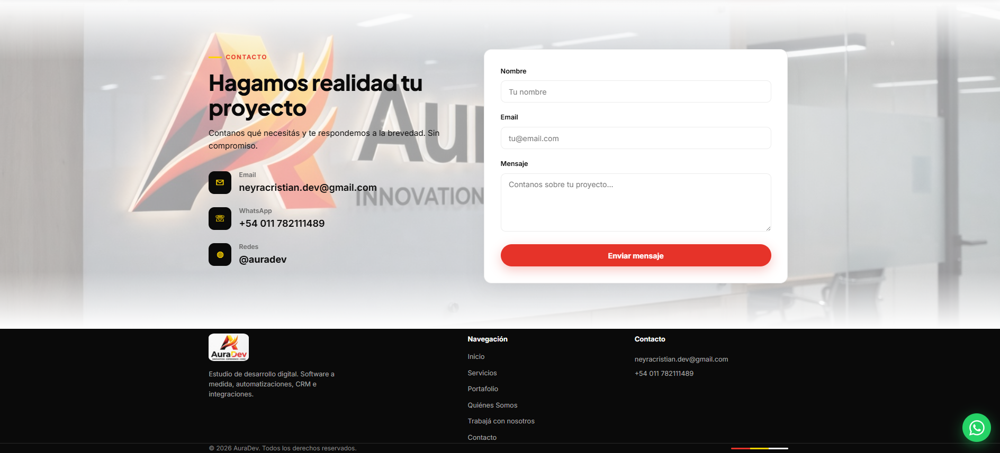

# AuraDev

<p align="center">
  
</p>

Sitio web del estudio **AuraDev**: presencia corporativa, portafolio de 6 proyectos y formulario de contacto con persistencia en PostgreSQL y alertas al equipo (email, Slack, Telegram, WhatsApp).

**Demo en vivo:** [auradevdev.vercel.app](https://auradevdev.vercel.app)

---

## Problema que resuelve

AuraDev necesita un sitio que presente servicios y proyectos reales, y un canal de contacto que no dependa solo del email manual: cada mensaje se valida, guarda en base de datos y notifica al equipo por varios canales.

## Por qué este stack

| Decisión | Razón |
|----------|--------|
| **React + Vite** | Build rápido, SPA con rutas para detalle de proyectos y bridge WhatsApp |
| **Express + TypeScript (API)** | Handler de contacto tipado, fácil de testear y desplegar en Vercel |
| **Drizzle + Neon** | PostgreSQL serverless, migraciones en `backend/drizzle/` |
| **Zod (front y back)** | Misma validación en cliente y servidor |
| **Vercel monorepo** | Frontend estático + `api/*.ts` en un solo deploy |

## Desafíos técnicos

- Notificaciones en serverless con `waitUntil`
- Rate limit distribuido (Upstash)
- WhatsApp Cloud API con plantilla Meta para 24/7
- Accesibilidad: teclado, focus trap, reduced motion; hero sin video en móvil

---

## Capturas

| Hero / preview | Servicios |
|:---:|:---:|
|  |  |

| Portafolio | Contacto |
|:---:|:---:|
|  |  |

---

## Stack

| Capa | Tecnología |
|------|------------|
| Frontend | React 18, Vite 6, TypeScript en componentes críticos |
| API | Node.js, Express, TypeScript, Zod |
| Base de datos | PostgreSQL (Neon) + Drizzle ORM (migraciones versionadas) |
| Seguridad | Helmet, CORS, honeypot, rate limit Upstash |
| Deploy | Vercel · [auradevdev.vercel.app](https://auradevdev.vercel.app) |

---

## Instalación local

```bash
git clone https://github.com/CrisNeyra/auradev.git
cd auradev
npm run install:all
cp frontend/.env.example frontend/.env
cp backend/.env.example backend/.env
npm run dev
```

Base de datos:

```bash
# Sync rápido (dev)
npm run db:migrate   # drizzle-kit migrate (usa backend/drizzle/)
# o
npm --prefix backend run db:push
```

Tests:

```bash
npm test
npm run test:e2e
npm run verify:rate-limit   # contra producción (Upstash)
```

---

## Documentación

| Documento | Contenido |
|-----------|-----------|
| [frontend/README.md](frontend/README.md) | Páginas, componentes y scripts Vite |
| [backend/README.md](backend/README.md) | Endpoints, env y schema |
| [docs/ARCHITECTURE.md](docs/ARCHITECTURE.md) | Diagrama del monorepo y decisiones |
| [docs/DATABASE.md](docs/DATABASE.md) | Tabla `mensajes` y migraciones Drizzle |
| [docs/CONTRIBUTING.md](docs/CONTRIBUTING.md) | Cómo contribuir y CI |
| [docs/vercel-checklist.md](docs/vercel-checklist.md) | Variables de producción |
| [docs/auto-respuesta.md](docs/auto-respuesta.md) | Mail de confirmación, WhatsApp e Instagram |

---

## Deploy

Checklist: [docs/vercel-checklist.md](docs/vercel-checklist.md)

- Upstash, LinkedIn/Instagram (`VITE_LINKEDIN_URL`, `VITE_INSTAGRAM_URL`)
- WhatsApp plantilla: [docs/whatsapp-template.md](docs/whatsapp-template.md)
- Auto-respuesta al cliente: [docs/auto-respuesta.md](docs/auto-respuesta.md)

---

## Contacto

[Formulario](https://auradevdev.vercel.app/#contacto) · hola@auradev.com

---

© AuraDev
