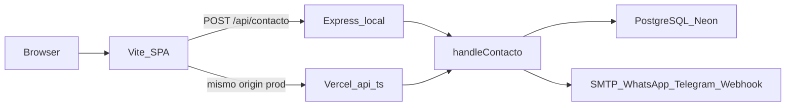
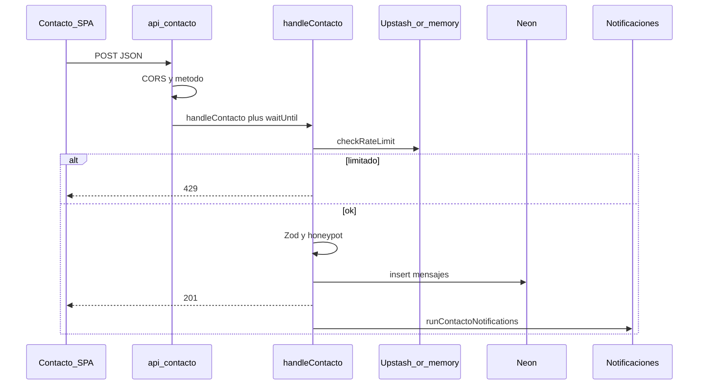

# Arquitectura AuraDev

Monorepo: sitio estático + API de contacto. Un deploy en Vercel; en local, Vite (5173) y Express (4000).

## Vista general

## Layout del repo

| Path | Rol |
|------|-----|
| `frontend/` | React + Vite |
| `backend/` | Express, Drizzle, handler compartido |
| `backend/src/notifications/` | Email, WhatsApp, Telegram y webhook (fuera del handler) |
| `api/` | Entrypoints serverless (`contacto`, `health`) |
| `docs/` | Arquitectura, DB, Vercel, WhatsApp |
| `scripts/` | Puertos, verify rate-limit |

## Decisiones

| Decisión | Por qué |
|----------|---------|
| Handler único `handleContacto` | Misma lógica en Express y Vercel; tests contra un solo módulo |
| Tipos `HttpRequestLike` / `HttpResponseLike` | Express y Node serverless no comparten `Request` de Express |
| Drizzle + Neon | Postgres serverless, migraciones en `backend/drizzle/` |
| Zod en cliente y servidor | UX inmediata + no confiar en el browser |
| `waitUntil` en Vercel | No cortar SMTP/WhatsApp al devolver 201 |
| Upstash + fallback memoria | Rate limit real en prod; local sin Redis |
| WhatsApp Cloud API + plantilla | Texto libre solo en ventana 24 h de Meta |
| CORS reflectivo, nunca `*` | Orígenes de env + `VERCEL_URL` |

## Request de contacto (producción)

## Observabilidad

- Logs JSON en Vercel (`logError`, `logNotifResult`, `logContactoBackup`).
- Contadores en memoria por instancia (`getMetricsSnapshot` en health local).
- Backup de contacto si no hay DB o el insert falla.

## Relacionado

- [DATABASE.md](DATABASE.md)
- [vercel-checklist.md](vercel-checklist.md)
- [whatsapp-template.md](whatsapp-template.md)
- [CONTRIBUTING.md](CONTRIBUTING.md)
