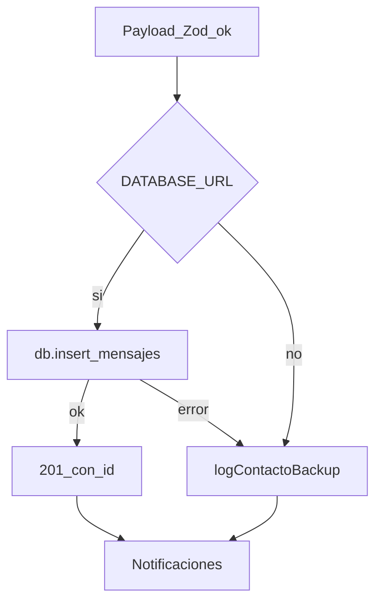

# Base de datos

PostgreSQL (Neon en producción). ORM: **Drizzle**. Schema: [`backend/src/db/schema.ts`](../backend/src/db/schema.ts). Cliente: [`backend/src/db/index.ts`](../backend/src/db/index.ts) (`DATABASE_URL`; SSL si el host es `neon.tech`).

Sin `DATABASE_URL` el API arranca igual: el contacto se acepta y se escribe backup en logs (en Vercel, Runtime Logs).

## Tabla `mensajes`

Leads del formulario. Un registro por envío válido (el honeypot no inserta).

| Columna | Tipo | Notas |
|---------|------|--------|
| `id` | `integer` identity PK | Generado por Postgres |
| `nombre` | `varchar(255)` not null | Recortado en el handler |
| `email` | `varchar(255)` not null | Validado con Zod |
| `mensaje` | `text` not null | Hasta 5000 caracteres en API |
| `creado_en` | `timestamptz` not null | Default `now()` |

SQL de la migración inicial: [`backend/drizzle/0000_init.sql`](../backend/drizzle/0000_init.sql).

## Migraciones

Config: [`backend/drizzle.config.ts`](../backend/drizzle.config.ts) (`out: ./drizzle`, dialect `postgresql`).

| Comando | Uso |
|---------|-----|
| `npm run db:migrate` (raíz) o `npm --prefix backend run db:migrate` | Aplica SQL versionado (`drizzle-kit migrate`) |
| `npm --prefix backend run db:push` | Empuja el schema (desarrollo) |
| `npm --prefix backend run db:generate` | Genera SQL nuevo tras cambiar `schema.ts` |

Journal: [`backend/drizzle/meta/_journal.json`](../backend/drizzle/meta/_journal.json). Migración actual: tag `0000_init`.

## Flujo en runtime

La respuesta HTTP es 201 aunque el insert falle: el dato queda en backup y las notificaciones igual se disparan.
